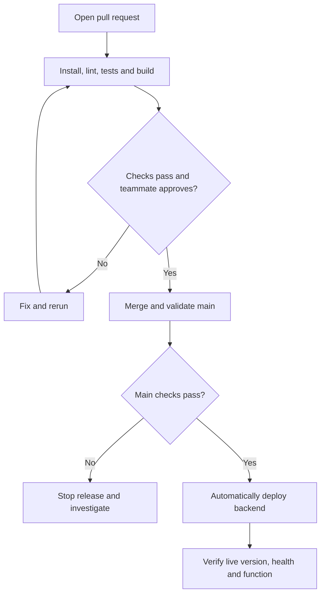

# Veriqo CI/CD Pipeline

## Current Status

The application pipeline is planned but not yet implemented
or verified.

Commands and runtime versions will be confirmed against
the developers' working code before configuration.

## Owner

Kendra Lynne Abellana — DevOps Engineer

## Planned Triggers

- Pull request: validate proposed changes.
- Push to main: validate the merged commit.
- Successful main validation: automatically deploy the backend.
- Controlled scheduled or manual run: small live AI smoke test.

## Planned Stages

| Stage | Purpose |
|---|---|
| Checkout | Obtain the code being checked |
| Runtime setup | Use the agreed Python and JavaScript tooling versions |
| Install | Install dependencies reproducibly |
| Lint | Check code quality before expensive work |
| Tests | Verify application behavior; mock AI calls in routine CI |
| Build/package | Validate the backend and package the extension |
| Deployment | Release the checked main commit automatically |
| Post-deploy checks | Verify health, deployed version, and application behavior |

Week 1 must include install, lint, build/package, and a
pipeline-triggered live deployment. Checks will expand
as the application is implemented.

## Planned Delivery Flow

## Quality Gates

- Main requires a pull request and at least one teammate approval.
- Confirm that the branch ruleset is active and enforced.
- Add required CI checks after the real workflow has run.
- Failed required checks must prevent merging.
- Application deployment must follow successful main checks.

## Secrets

- Never commit real secrets.
- Document required variable names in .env.example.
- Configure real values in the appropriate secret stores.
- Keep AI keys and database credentials out of the extension.
- Do not provide production secrets to untrusted PR jobs.

## AI Testing

- Routine automated tests use mocked AI responses.
- Real provider smoke tests use bounded requests and spending.
- Relevant prompt/model changes receive evaluation checks.
- Provider failure must not appear as a legitimate classification.

## Extension Delivery

Backend deployment and extension distribution are separate.

CI will build a versioned extension package. Building a package
does not automatically update installed extensions.

Document and rehearse the instructor-approved installation
and update method.

## Measurements

Record actual run links and measurements in
docs/PIPELINE_METRICS.md.

Track PR/main duration, success rate, deployment count,
merge-to-live time, failed deployments, and recovery time.

## Developer Handoff Needed

- Repository directories and runtime versions.
- Install, lint, test, and build/package commands.
- Backend start and migration commands.
- Required environment variable names.
- Health endpoint and deployed-version identifier.

## Completion Evidence

Add workflow paths, successful run links, deployment links,
and verification results after implementation.
